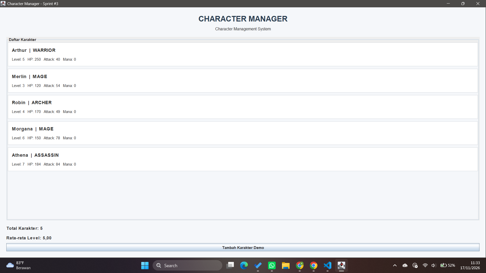
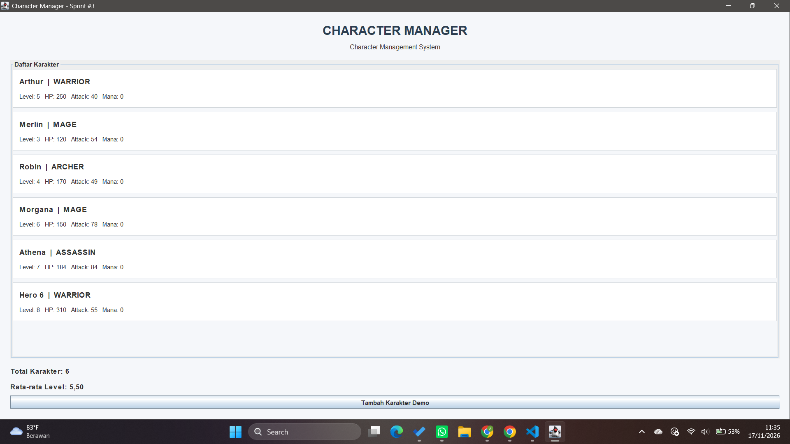

# Character Manager - Sprint #3
## MainWindow, Data Dinamis & Analisis MVC

### 1. Deskripsi Proyek
Character Manager Sprint #3 merupakan pengembangan aplikasi berbasis Java menggunakan Swing GUI. Aplikasi ini menampilkan data karakter secara dinamis melalui komponen JFrame, JPanel, dan JLabel.

Data karakter dikelola menggunakan class CharacterManager, kemudian ditampilkan pada MainWindow. Aplikasi juga menghitung jumlah karakter dan rata-rata level secara otomatis.

### 2. Fitur yang Dikembangkan
- Menampilkan data karakter menggunakan Java Swing.
- Menampilkan minimal lima karakter.
- Menampilkan nama, tipe, level, HP, attack power, dan mana.
- Menghitung jumlah karakter secara otomatis.
- Menghitung rata-rata level karakter.
- Menambahkan karakter melalui tombol Tambah Karakter Demo.
- Memperbarui tampilan dan statistik setelah data berubah.
- Membuat GUI menggunakan SwingUtilities.invokeLater().

### 3. Struktur Folder
```text
CharacterManager/
├── src/
│   └── com/unpri/charactermanager/
│       ├── Main.java
│       ├── model/
│       │   ├── Character.java
│       │   ├── CharacterType.java
│       │   └── CharacterManager.java
│       └── view/
│           └── MainWindow.java
├── screenshots/
│   ├── tp8-before.png
│   └── tp8-after.png
└── README.md
```

### 4. Data Karakter
Karakter yang ditampilkan pada aplikasi:
1. Arthur - WARRIOR, Level 5
2. Merlin - MAGE, Level 3
3. Robin - ARCHER, Level 4
4. Morgana - MAGE, Level 6
5. Athena - ASSASSIN, Level 7

Setelah tombol Tambah Karakter Demo ditekan, aplikasi menambahkan Hero 6 dengan tipe WARRIOR dan Level 8.

### 5. Screenshot Aplikasi

#### Tampilan Sebelum Penambahan Karakter


Jumlah karakter: 5  
Total level: 25  
Rata-rata level: 5.00

#### Tampilan Setelah Penambahan Karakter


Jumlah karakter: 6  
Total level: 33  
Rata-rata level: 5.50

### 6. Alur Data dan Konsep MVC
Alur aplikasi dimulai dari class Main yang membuat objek CharacterManager dan mengisi data karakter. Selanjutnya, objek CharacterManager diberikan kepada MainWindow untuk mengakses dan menampilkan data karakter. MainWindow menggunakan perulangan untuk membaca seluruh karakter dan menampilkannya melalui komponen JLabel. Ketika pengguna menekan tombol tambah karakter, data diperbarui melalui CharacterManager dan tampilan serta statistik dimuat kembali.

Dalam konsep MVC:
- **Model:** Character, CharacterType, dan CharacterManager mengelola data serta aturan aplikasi.
- **View:** MainWindow bertanggung jawab menampilkan data dalam bentuk GUI.
- **Controller:** Pada versi ini, pengelolaan alur masih sederhana dan sebagian interaksi ditangani melalui event listener di MainWindow.

### 7. Teknologi yang Digunakan
- Java JDK 17
- Visual Studio Code
- Java Swing
- Java Extension Pack

### 8. Cara Menjalankan Program
1. Buka folder proyek menggunakan Visual Studio Code.
2. Pastikan JDK 17 sudah terpasang.
3. Buka file Main.java.
4. Jalankan program melalui tombol Run Java.
5. Jendela Character Manager akan muncul.
6. Tekan tombol Tambah Karakter Demo untuk menguji perubahan data dan statistik.

### 9. Analisis Tugas
Dokumentasi analisis tugas TP8 membahas:
- Perbedaan pemrograman sequential dan event-driven.
- Fungsi SwingUtilities.invokeLater().
- Penggunaan JFrame dan setVisible(true).
- Konsep hubungan is-a dan has-a.
- Pembagian tanggung jawab Model dan View dalam MVC.

**Link Google Docs Analisis:**  
[(https://docs.google.com/document/d/1Hj7ydaICSuB1yNE1RJtG0xxb4lDeT7WdjJKfeLuvxrA/edit?usp=sharing)]

---

**Mata Kuliah:** Java Visual  
**Program Studi:** Sarjana Sistem Informasi  
**Universitas:** Universitas Prima Indonesia
